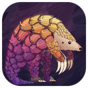
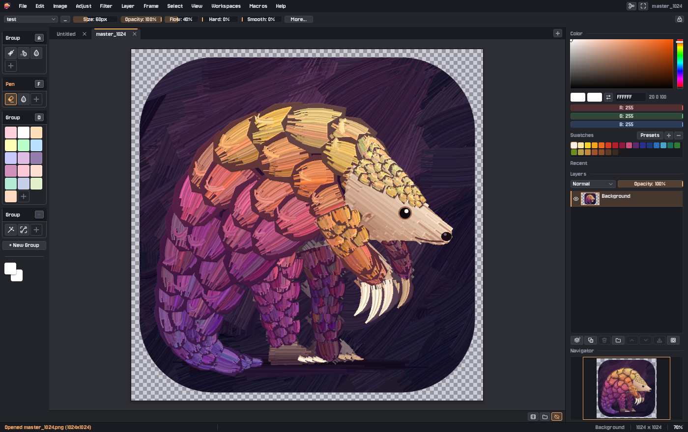
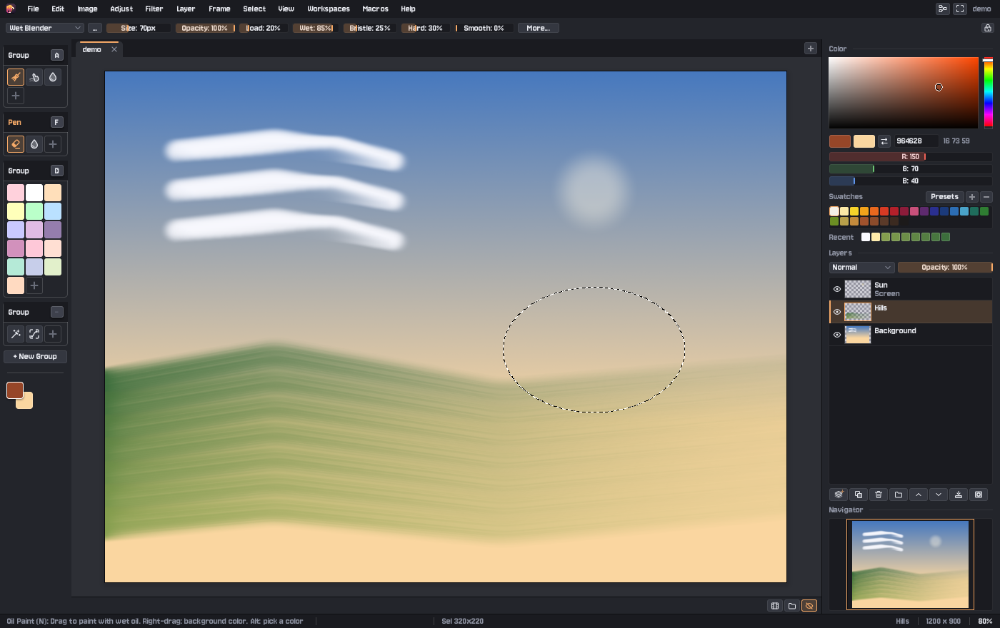
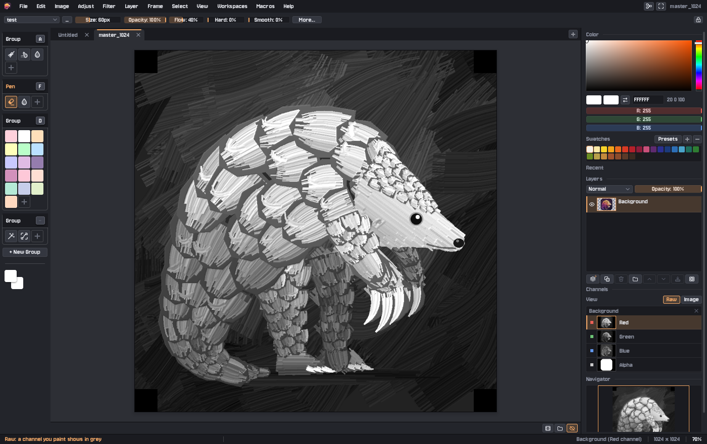
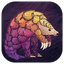

  

<h1 align="center">Pangolin Paints</h1>

<em>Brushstrokes, scale by scale.</em>

  A painting app with natural brushes and real wet oil paint, plus the photo tools you'd expect. 
  Free and open source, for Windows, macOS and Linux.

  <a href="https://github.com/BrandonHilde/PangolinPaints/releases"><strong>Download the beta</strong></a>
  ·
  <a href="GUIDE.md">Guide</a>
  ·
  <a href="DEVELOPING.md">For developers</a>

## Download

**Version 0.9.0-beta.** This is a beta: it's ready to use, and we'd love to hear what goes wrong.

| Your computer | Download |
|---|---|
| **Windows** 10 or 11 | [PangolinPaints-0.9.0-beta-windows.zip](https://github.com/BrandonHilde/PangolinPaints/releases/download/v0.9.0-beta/PangolinPaints-0.9.0-beta-windows.zip) |
| **macOS** 11 or later, Apple silicon (M1 or newer) | [PangolinPaints-0.9.0-beta-macos.zip](https://github.com/BrandonHilde/PangolinPaints/releases/download/v0.9.0-beta/PangolinPaints-0.9.0-beta-macos.zip) |
| **Linux**, 64-bit (Ubuntu 22.04, Fedora 36, Debian 12 or newer) | [PangolinPaints-0.9.0-beta-linux.tar.gz](https://github.com/BrandonHilde/PangolinPaints/releases/download/v0.9.0-beta/PangolinPaints-0.9.0-beta-linux.tar.gz) |

All versions are on the [releases page](https://github.com/BrandonHilde/PangolinPaints/releases).

### Getting started

1. **Unzip** the download anywhere you like. Nothing needs installing.
2. **Open** `PangolinPaints.exe` (Windows), `Pangolin Paints.app` (macOS) or `PangolinPaints` (Linux).
3. **The first time only**, your computer may want to check with you, because the beta isn't signed yet:
   - **Windows:** "Windows protected your PC". Click **More info**, then **Run anyway**.
   - **macOS:** it says the app can't be opened. Go to **System Settings > Privacy & Security** and click
     **Open Anyway**. On macOS 14 or earlier, right-click the app and choose **Open**.

Each download has an `INSTALL.txt` with the details, including where your settings are kept.

## What you can do

- **Paint with natural brushes**: pencil, ink, marker, chalk, charcoal, watercolor wash, airbrush, calligraphy and
  more, each with size, hardness, texture and smoothing you can tune and save as your own presets.
- **Paint in wet oils.** The oil brushes carry paint, pick up the color already on the canvas, run dry and leave
  bristle streaks, with presets from a detail sable to a palette knife and thick impasto.
- **Blend and touch up** with smudge, blur, sharpen, dodge, burn and a clone stamp.
- **Use layers** with 17 blend modes, layer masks, groups, editable text and live effects.
- **Edit photos**: levels, curves, hue and saturation, color balance, blurs, sharpening and more, all with a live
  preview, plus selections with feathering and a smart select tool that follows edges.
- **Paint on a single color channel.** Right-click a layer and choose **Expose Color Channels** to paint on its red,
  green, blue or alpha alone, and see that channel in grey with **Raw** view.
- **Get help with composition** from mirror symmetry (kaleidoscopes too), perspective guides with up to three
  vanishing points, a grid, and seamless tiling for textures.
- **Animate** a painting frame by frame, with onion skin, playback and animated GIF export.
- **Draw with a tablet.** Pen pressure, tilt and the eraser end work with Wacom, Huion and similar tablets.
- **Open your files**, including Photoshop (`.psd`) and Krita (`.kra`) files with their layers, along with PNG, JPG,
  WebP, TIFF and more. Export to PNG, JPG, TIFF, BMP, TGA and QOI.

Every control tells you what it does when you rest the pointer on it, and **F1** lists all the shortcuts. The
[full guide](GUIDE.md) covers everything in detail.

## The Pangolin family

Three editors with the same look and feel, so what you learn in one carries over to the others.

| | | |
|---|---|---|
|  | **[Pangolin Pixels](https://github.com/BrandonHilde/PangolinPixels)**: pixel art and sprite animation | [Download](https://github.com/BrandonHilde/PangolinPixels/releases) |
|  | **[Pangolin Paints](https://github.com/BrandonHilde/PangolinPaints)**: painting, oil paint and photo editing | [Download](https://github.com/BrandonHilde/PangolinPaints/releases) |
|  | **[Pangolin Scales](https://github.com/BrandonHilde/PangolinScales)**: vector drawings (SVG) and fonts | [Download](https://github.com/BrandonHilde/PangolinScales/releases) |

## Found a problem? Have an idea?

[Open an issue](https://github.com/BrandonHilde/PangolinPaints/issues). Please say which computer you're on and the
version from **Help > About**. A screenshot helps a lot.

## For developers

Pangolin Paints is written in [Odin](https://odin-lang.org) with SDL3. [DEVELOPING.md](DEVELOPING.md) covers building
it, running the tests, and how the release builds are made.

## License

BSD 3-Clause. See [LICENSE](LICENSE).
